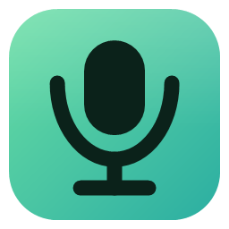
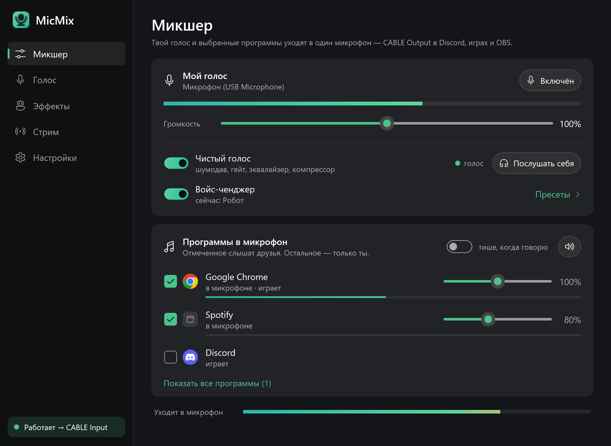
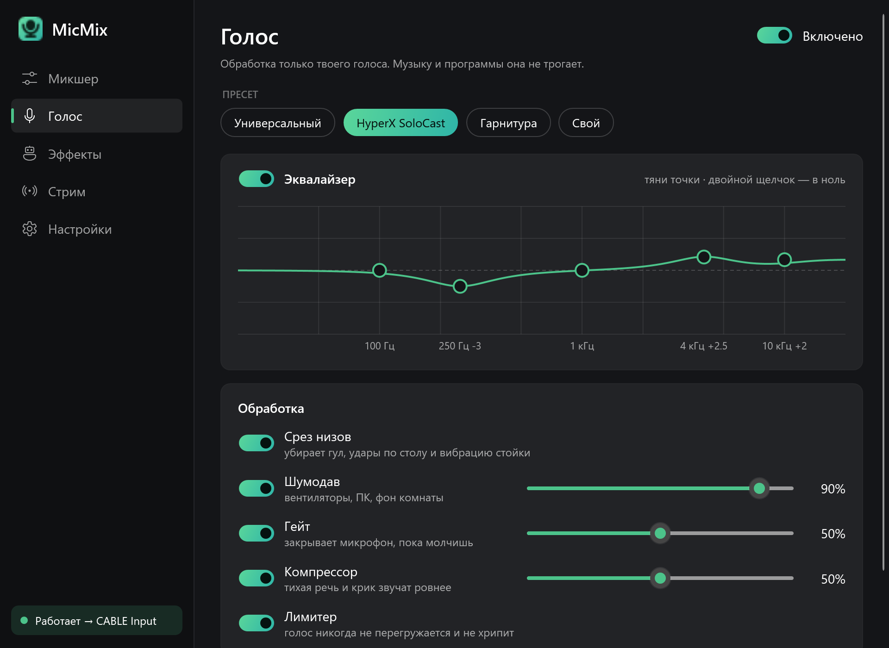
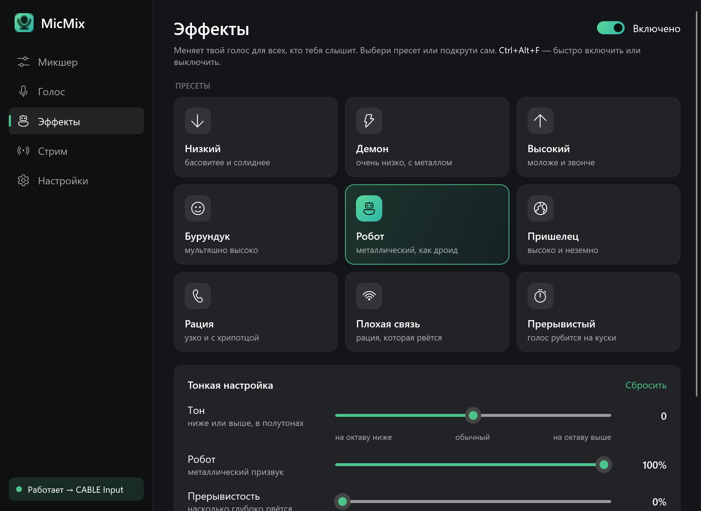
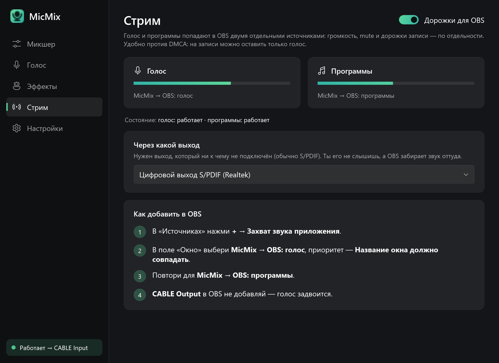
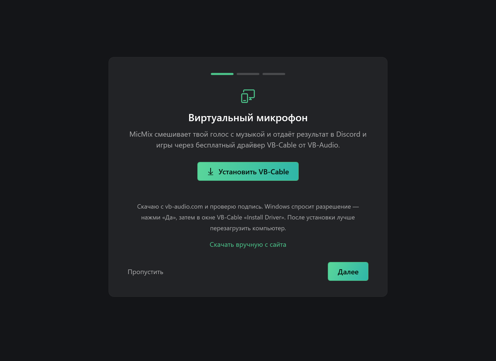
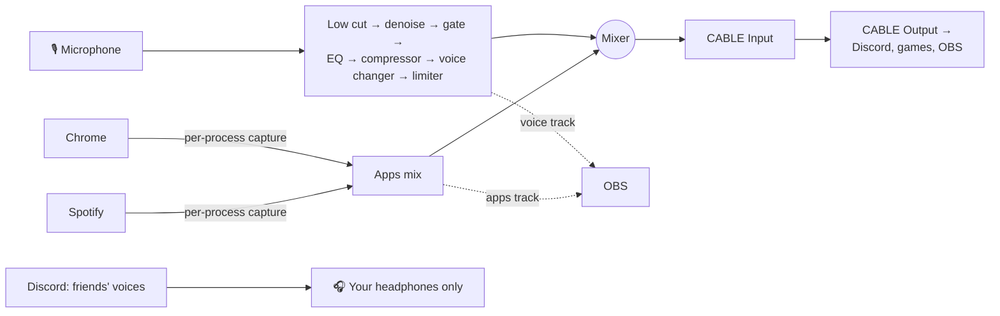

<div align="center">



# MicMix

**Your voice and the apps you pick — in one microphone.**<br />
Friends on Discord hear you and the music from your browser, but not themselves.

[Русский](README.md) · **English**

[](https://github.com/D4nk0v/MicMix/releases/latest)
[](https://github.com/D4nk0v/MicMix/actions/workflows/build.yml)


[](LICENSE)



<sub>The interface is in Russian; this page describes every screen in English.</sub>

</div>

## Why

Want to play music or a video to your friends right in voice chat? You need a "virtual mixer". Voicemeeter can do it, but setting it up is painful, and one wrong checkbox makes your friends hear themselves on Discord.

**MicMix does one thing, simply:** tick an app and your friends hear it. Everything else, including their voices, stays in your headphones.

## Contents

- [Features](#features)
  - [Mixer: any app into the mic](#-mixer-any-app-into-the-mic)
  - [Clean voice](#-clean-voice)
  - [Effects: voice changer](#-effects-voice-changer)
  - [App audio "as in your headphones"](#-app-audio-as-in-your-headphones)
  - [Streaming: separate OBS tracks](#-streaming-separate-obs-tracks)
  - [Hotkeys](#️-hotkeys)
  - [Convenience and reliability](#-convenience-and-reliability)
- [Install](#install)
- [FAQ](#faq)
- [How it works](#how-it-works)
- [Build from source](#build-from-source)

## Features

### 🎚 Mixer: any app into the mic

- **Pick anything** — a browser, Spotify, a game, a player, a video. The list shows every open program, even ones that are silent yet, so you can tick them in advance.
- **Audio is captured per app**, not from the whole PC. Only what you tick goes into the mic — your friends' voices from Discord never do.
- **Per-app volume** from 0 to 200%, with a level meter next to each app.
- **"Remove all apps"** with one button or a hotkey — the ticks stay.
- **"Going into the mic" meter** — see exactly what your friends hear.
- **Mistake guards:** if some program plays straight into the virtual cable (so everyone hears it), MicMix warns you. Discord and other voice chats can be ticked, but with an echo warning.

### 🎙 Clean voice



A processing chain for your voice only — it never touches the music. Every stage can be switched on or off.

| Stage | What it does |
|---|---|
| **Low cut** | 80 Hz filter: removes rumble, desk bumps and stand vibration. |
| **Noise suppression** | Neural RNNoise: fans, keyboard, room noise. Adjustable strength — turn it down if your voice gets "robotic". |
| **Gate** | Closes the mic while you're silent. Driven by speech detection, not loudness, so quiet words aren't cut. |
| **Equalizer** | 5 bands (100 Hz – 10 kHz); drag the curve with the mouse, double-click to reset. |
| **Compressor** | Quiet talk and shouting come out more even. |
| **Limiter** | Your voice never clips or distorts. |

- **Presets:** "Universal", "HyperX SoloCast" (USB condenser), "Headset". On first run the preset is picked from your mic's name. Any tweak switches to "Custom".
- **"Listen to myself"** — the processed voice in your own headphones, to tune by ear.

### 🤖 Effects: voice changer



| Control | What it does |
|---|---|
| **Pitch** | Lower or higher by ±12 semitones (up to an octave) without changing the speed of speech. |
| **Robot** | Metallic ring, from subtle to full droid. |
| **Radio** | Narrow band and a little crunch, like a walkie-talkie. |
| **Choppy** | The voice breaks into pieces: depth and rate of the drop-outs (2–20 per second). |

**9 one-click presets:** Deep · Demon · High · Chipmunk · Robot · Alien · Radio · Bad signal · Choppy. Click a tile and the effect switches on. **Ctrl+Alt+F** toggles it; there's also a switch on the main screen.

### 🎧 App audio "as in your headphones"

- **By default, app audio reaches the mic bit-for-bit** — no processing at all, exactly as you hear it.
- Optional (Settings → "App audio in the mic"):
  - **Level volume** — quiet and loud videos sound the same;
  - **Cut sub-bass** — removes rumble below 60 Hz;
  - **Quieter when I talk** — music makes room for your voice (by 3–20 dB). Triggers on confident speech only, not on clicks or breaths.

### 📺 Streaming: separate OBS tracks



- Voice and apps reach OBS as **two separate sources**: volume, mute and recording tracks are independent.
- Handy against DMCA: keep only your voice in the recording.
- Uses an output nothing is plugged into (usually S/PDIF) — you don't hear it, and OBS picks the sound up with "Application Audio Capture". Step-by-step instructions are built into the app.

### ⌨️ Hotkeys

They work everywhere, even in a fullscreen game, and are confirmed with a short beep in your headphones (can be turned off). Every one can be reassigned.

| Default | Action |
|---|---|
| `Ctrl+Alt+K` | Mute / unmute my voice |
| `Ctrl+Alt+N` | Remove / restore apps |
| `Ctrl+Alt+V` | Clean voice on / off |
| `Ctrl+Alt+L` | Listen to myself on / off |
| `Ctrl+Alt+F` | Voice changer on / off |

### 🧩 Convenience and reliability



- **Works out of the box.** A single `MicMix.exe`; no .NET install needed.
- **First-run wizard** downloads the free VB-Cable driver from the official site, **verifies its digital signature** and starts the installer. Then it helps you pick your mic and tells you what to select in Discord.
- **Lives in the tray:** the close button hides the window, and the icon turns red while your voice is muted. Can start with Windows (minimized).
- **Self-healing:** when a device changes or disappears, or an audio stream fails, the engine restarts on its own.
- **Lightweight:** device polling costs next to nothing; voice processing takes a few percent of one CPU core.
- **No accounts, no telemetry:** the only network access is downloading the VB-Cable installer. Settings live in `%AppData%\MicMix`.

## Install

1. Download `MicMix-x.y.z-win-x64.zip` from [Releases](https://github.com/D4nk0v/MicMix/releases/latest) and unzip it.
2. Run `MicMix.exe`. If Windows shows "Windows protected your PC", click "More info" → "Run anyway" (the exe has no paid code-signing certificate).
3. The wizard installs VB-Cable (Windows asks for permission — "Yes", then "Install Driver") and helps you choose your mic.
4. In Discord and games, select the **CABLE Output** microphone.

**Requirements:** Windows 10 version 2004 or later, or Windows 11, 64-bit.

## FAQ

<details>
<summary><b>Friends say the music is quiet or keeps cutting out</b></summary>

It's almost always Discord: its noise suppression (Krisp) treats music as noise. Discord → Settings → Voice & Video → turn off **Noise Suppression**, **Echo Cancellation** and **Automatic Gain Control**. MicMix does this itself and leaves the music alone.
</details>

<details>
<summary><b>Friends hear themselves</b></summary>

Discord got into the mic. Untick it in the Mixer. If MicMix shows the red "Extra sound in the mic" warning, change the output device of the program it names to your headphones.
</details>

<details>
<summary><b>How to uninstall</b></summary>

Turn off "Start with Windows" in Settings, quit MicMix from the tray and delete `MicMix.exe`. Settings are in `%AppData%\MicMix`. VB-Cable is removed with its own installer ("Remove Driver").
</details>

## How it works



| Problem | Solution |
|---|---|
| One app's audio | Windows Process Loopback API (`ActivateAudioInterfaceAsync`, "process and its children" mode). NAudio keeps this API internal, so MicMix has its own COM wrapper. |
| Denoising and speech detection | RNNoise, 10 ms frames at 48 kHz. Music ducking uses a separate strict detector: 0% false triggers on a real mic's silence versus 6–19% for the regular one. |
| Pitch shift | Phase vocoder: 2048-point FFT, 4× overlap, 32 ms latency. Within 1 cent on a test tone across the whole ±12 semitone range. |
| Devices on different clocks | A ring buffer with drift correction (jitter buffer) on every input. |
| Output clipping | A limiter just under 0 dBFS: anything below the ceiling passes through untouched. |
| OBS tracks | MicMix helper processes with their own windows, fed over a named pipe locked to your user account and to the helper MicMix started. |
| UI | WPF (.NET 9) with the Fluent theme, MVVM without third-party frameworks. |

## Build from source

Requires the [.NET 9 SDK](https://dotnet.microsoft.com/download/dotnet/9.0).

```bash
git clone https://github.com/D4nk0v/MicMix.git
cd MicMix
dotnet publish MicMix/MicMix.csproj -c Release -o publish
```

The result is a single `publish/MicMix.exe` (self-contained, single-file).

Helper tools:

```bash
dotnet run -c Release --project tools/Screenshots -- docs/screenshots 700
```

```bash
powershell -NoProfile -ExecutionPolicy Bypass -File tools/make-icon.ps1
```

The first re-renders the screenshots on this page (demo mode: no audio, none of your devices or settings); the second redraws the icon at every size.

## License

[MIT](LICENSE). Third-party components and their licenses are listed in [THIRD-PARTY-NOTICES.md](THIRD-PARTY-NOTICES.md). VB-Cable is not included in the repository or releases: MicMix downloads it from [vb-audio.com](https://vb-audio.com/Cable/) during setup. If you use it, consider supporting VB-Audio.
