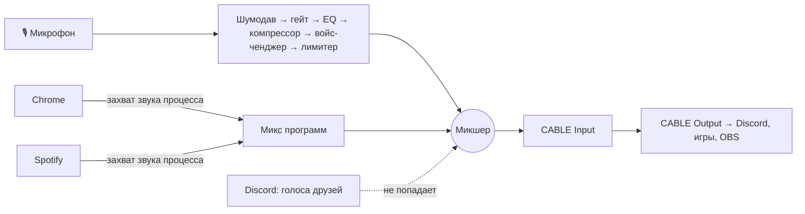

<div align="center">


# MicMix

**Твой голос и звук выбранных программ — в одном микрофоне.**
Друзья в Discord слышат тебя и музыку из браузера, но не самих себя.

[](https://github.com/D4nk0v/MicMix/actions/workflows/build.yml)


[](LICENSE)

[**Скачать**](https://github.com/D4nk0v/MicMix/releases/latest) · [English](#english)


</div>

## Зачем

Voicemeeter умеет пускать звук программ в микрофон, но настраивать его — боль, а одна неверная галочка — и друзья слышат в Discord сами себя.
MicMix решает одну задачу и делает это просто: **отметь программу галочкой — её слышат друзья. Остальное слышишь только ты.**

## Возможности

- 🎚 **Любая программа в микрофон.** Браузер, Spotify, игра, плеер — выбирай из списка всех открытых программ. Звук берётся у каждой программы отдельно, а не со всего компьютера, так что голоса друзей из Discord в микрофон не попадают.
- 🎙 **Чистый голос.** Нейросетевой шумодав RNNoise, гейт по детектору речи, 5-полосный эквалайзер с перетаскиваемой кривой, компрессор и лимитер. Готовые пресеты под USB-микрофон (HyperX SoloCast), гарнитуру и универсальный.
- 🤖 **Войс-ченджер.** Тон ±12 полутонов, робот, рация, прерывистость и 9 пресетов: Низкий, Демон, Высокий, Бурундук, Робот, Пришелец, Рация, Плохая связь, Прерывистый.
- 🎧 **Как в наушниках.** По умолчанию звук программ идёт в микрофон бит в бит, без обработки. Выравнивание громкости, срез сабнизов и приглушение музыки под голос — по желанию.
- 📺 **Для стримов.** Отдельные дорожки «голос» и «программы» для OBS — громкость, mute и запись по отдельности (удобно против DMCA).
- ⌨️ **Горячие клавиши, работающие в игре.** Выключить голос, убрать программы, войс-ченджер, «послушать себя» — со звуковым сигналом в наушниках.
- 🧩 **Работает из коробки.** Один exe без установки .NET. Мастер первого запуска сам скачивает бесплатный драйвер VB-Cable с официального сайта и проверяет его цифровую подпись.

| Голос | Эффекты | Стрим |
|---|---|---|
|  |  |  |

## Установка

1. Скачай `MicMix-x.y.z-win-x64.zip` из [Releases](https://github.com/D4nk0v/MicMix/releases/latest) и распакуй.
2. Запусти `MicMix.exe`. Если Windows покажет «Windows защитила ваш компьютер» — «Подробнее» → «Выполнить в любом случае» (у exe нет платной подписи).
3. Мастер установит виртуальный микрофон VB-Cable и поможет выбрать твой микрофон.
4. В Discord и играх выбери микрофон **CABLE Output**. В Discord выключи шумоподавление, эхоподавление и автоусиление — MicMix делает это сам, а Discord иначе режет музыку.

Требования: Windows 10 2004+ или Windows 11, x64.

## Как это устроено



- **Захват звука отдельной программы** — Windows Process Loopback API (`ActivateAudioInterfaceAsync` + `PROCESS_LOOPBACK_MODE_INCLUDE_TARGET_PROCESS_TREE`), собственная обёртка над COM, т. к. в NAudio этот API закрыт.
- **Шумодав** — RNNoise (кадры по 10 мс при 48 кГц); его детектор речи управляет гейтом и приглушением музыки. Для приглушения отдельный, строгий детектор: на тишине реального микрофона ложных срабатываний 0% против 6–19% у обычного.
- **Сдвиг тона** — фазовый вокодер (FFT 2048, перекрытие 4×, задержка 32 мс). Точность на тестовом тоне — до 1 цента во всём диапазоне ±12 полутонов.
- **Синхронизация часов** устройств — кольцевой буфер с подстройкой (jitter buffer) на каждом входе.
- **Дорожки для OBS** — вспомогательные процессы MicMix, каждый со своим окном, чтобы OBS «Захват звука приложения» видел их по отдельности.
- **Интерфейс** — WPF (.NET 9) с темой Fluent, MVVM без сторонних фреймворков.

## Сборка из исходников

```bash
git clone https://github.com/D4nk0v/MicMix.git
cd MicMix/MicMix
dotnet publish -c Release -o ../publish
```

Нужен .NET 9 SDK. Результат — один `MicMix.exe` (self-contained, single-file).

## Лицензия

[MIT](LICENSE). Сторонние компоненты и их лицензии — в [THIRD-PARTY-NOTICES.md](THIRD-PARTY-NOTICES.md). VB-Cable в репозитории и релизах нет: MicMix скачивает его с [vb-audio.com](https://vb-audio.com/Cable/) во время установки.

---

## English

**MicMix** routes your voice plus the apps you pick (browser, Spotify, a game) into one virtual microphone for Discord, games and OBS. Everything else — like your friends' voices — stays in your headphones only.

- Per-app capture via the Windows process-loopback API (any running program can be selected).
- Voice chain: RNNoise denoiser, speech gate, draggable 5-band EQ, compressor, limiter, presets.
- Voice changer: phase-vocoder pitch shift (±12 semitones), robot, radio, choppy; 9 presets.
- Apps pass through bit-exact by default; optional leveler, low cut and ducking under your voice.
- Separate voice / apps tracks for OBS, global hotkeys that work in-game, single self-contained exe with a first-run wizard that installs VB-Cable from the official site after verifying its signature.

Download from [Releases](https://github.com/D4nk0v/MicMix/releases/latest). Windows 10 2004+ / 11, x64. MIT licensed.
