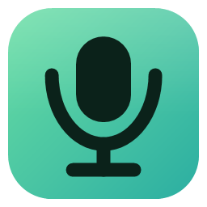
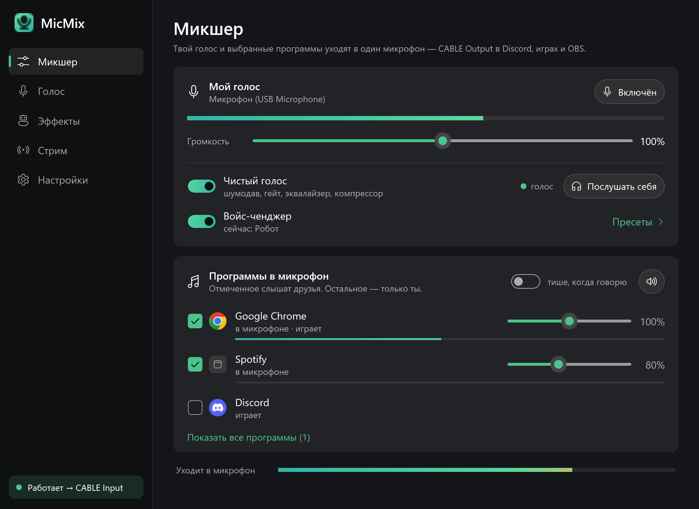
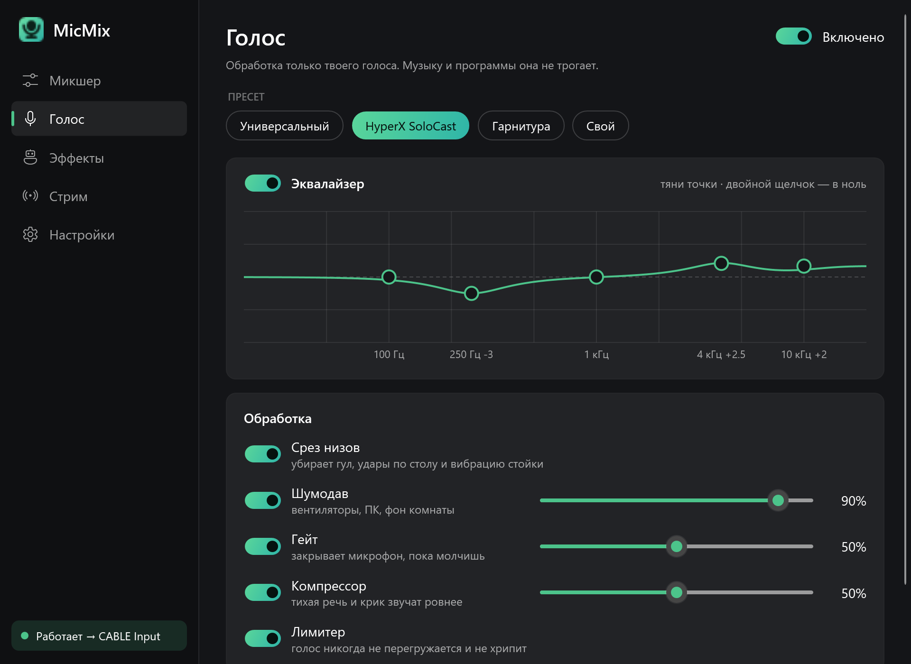
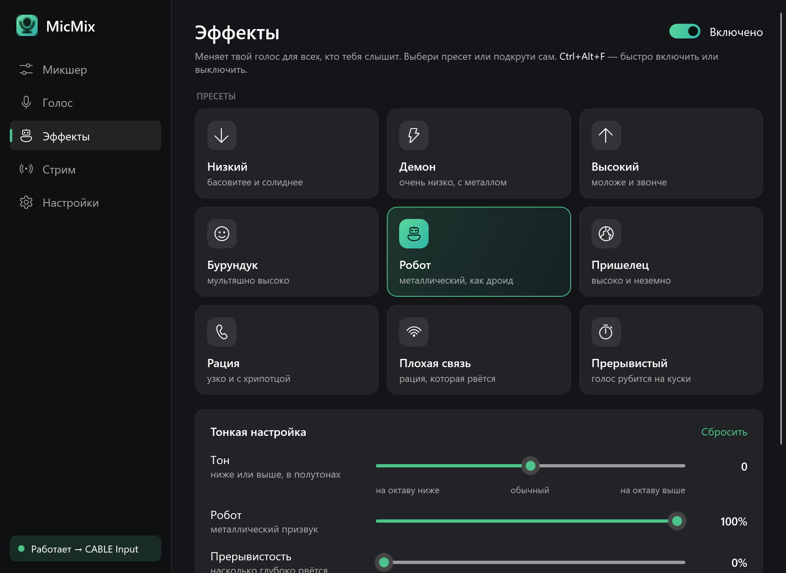
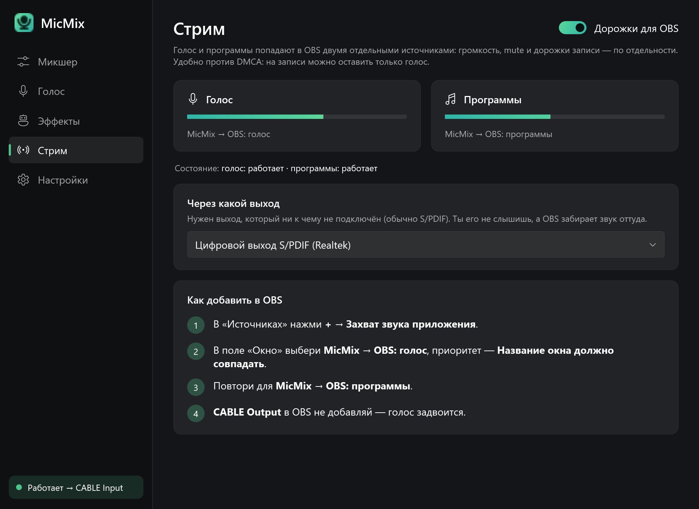
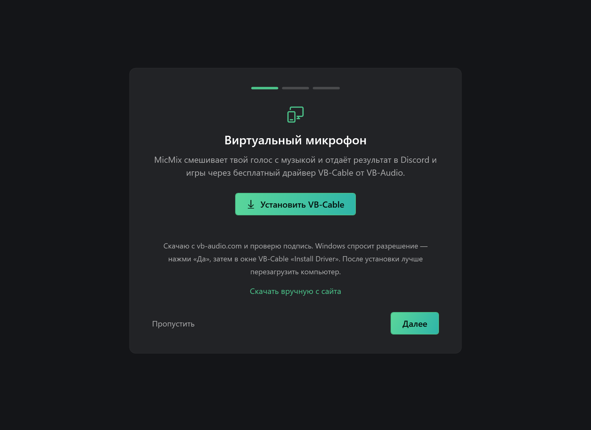
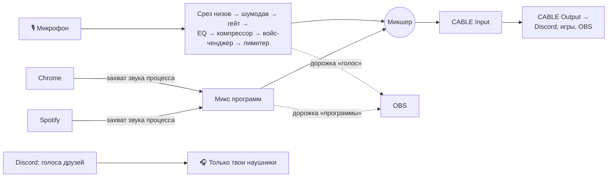

<div align="center">



# MicMix

**Твой голос и звук выбранных программ — в одном микрофоне.**<br />
Друзья в Discord слышат тебя и музыку из браузера, но не самих себя.

**Русский** · [English](README.en.md)

[](https://github.com/D4nk0v/MicMix/releases/latest)
[](https://github.com/D4nk0v/MicMix/actions/workflows/build.yml)


[](LICENSE)



</div>

## Зачем это

Хочешь включить друзьям музыку или видео прямо в голосовой чат — нужен «виртуальный микшер». Voicemeeter умеет, но его настройка — боль, а одна неверная галочка — и друзья слышат в Discord сами себя.

**MicMix делает одно и делает это просто:** отметь программу галочкой — её слышат друзья. Всё остальное, включая их голоса, слышишь только ты.

## Содержание

- [Возможности](#возможности)
  - [Микшер: любая программа в микрофон](#-микшер-любая-программа-в-микрофон)
  - [Чистый голос](#-чистый-голос)
  - [Эффекты: войс-ченджер](#-эффекты-войс-ченджер)
  - [Звук программ «как в наушниках»](#-звук-программ-как-в-наушниках)
  - [Стрим: отдельные дорожки для OBS](#-стрим-отдельные-дорожки-для-obs)
  - [Горячие клавиши](#️-горячие-клавиши)
  - [Удобство и надёжность](#-удобство-и-надёжность)
- [Установка](#установка)
- [Частые вопросы](#частые-вопросы)
- [Как это устроено](#как-это-устроено)
- [Сборка из исходников](#сборка-из-исходников)

## Возможности

### 🎚 Микшер: любая программа в микрофон

- **Выбирай что угодно** — браузер, Spotify, игру, плеер, видео. В списке все открытые программы, даже те, что ещё молчат: можно отметить заранее.
- **Звук берётся у каждой программы отдельно**, а не со всего компьютера. Поэтому в микрофон попадает только отмеченное, а голоса друзей из Discord — нет.
- **Громкость каждой программы** от 0 до 200% и индикатор уровня рядом.
- **«Убрать все программы»** одной кнопкой или горячей клавишей — галочки при этом остаются.
- **Индикатор «Уходит в микрофон»** — видно, что именно слышат друзья.
- **Защита от ошибок:** если какая-то программа выводит звук прямо в виртуальный кабель (и её слышат все), MicMix предупредит. Discord и другие голосовые чаты выбрать можно, но с предупреждением про эхо.

### 🎙 Чистый голос



Цепочка обработки только для твоего голоса — музыку она не трогает. Каждый шаг включается отдельно.

| Шаг | Что делает |
|---|---|
| **Срез низов** | Фильтр 80 Гц: убирает гул, удары по столу и вибрацию стойки. |
| **Шумодав** | Нейросетевой RNNoise: вентиляторы, клавиатура, фон комнаты. Сила регулируется — если голос стал «роботным», убавь. |
| **Гейт** | Закрывает микрофон, пока ты молчишь. Работает от детектора речи, а не от громкости, поэтому не обрезает тихие слова. |
| **Эквалайзер** | 5 полос (100 Гц – 10 кГц), кривая перетаскивается мышью, двойной щелчок — в ноль. |
| **Компрессор** | Тихая речь и крик звучат ровнее. |
| **Лимитер** | Голос никогда не перегружается и не хрипит. |

- **Пресеты:** «Универсальный», «HyperX SoloCast» (USB-конденсатор), «Гарнитура». При первом запуске пресет подбирается по названию микрофона. Любая правка — и включается «Свой».
- **«Послушать себя»** — обработанный голос в твоих наушниках, чтобы настраивать на слух.

### 🤖 Эффекты: войс-ченджер



| Настройка | Что делает |
|---|---|
| **Тон** | Ниже или выше на ±12 полутонов (до октавы), без изменения скорости речи. |
| **Робот** | Металлический призвук, от лёгкого до дроида. |
| **Рация** | Узкая полоса и лёгкий хрип, как в радиопереговорах. |
| **Прерывистость** | Голос рвётся на куски: глубина и частота обрывов (2–20 раз в секунду). |

**9 пресетов одним нажатием:** Низкий · Демон · Высокий · Бурундук · Робот · Пришелец · Рация · Плохая связь · Прерывистый. Нажал на плитку — эффект сразу включился. **Ctrl+Alt+F** — быстро включить или выключить, переключатель есть и на главном экране.

### 🎧 Звук программ «как в наушниках»

- **По умолчанию звук программ идёт в микрофон бит в бит** — без какой-либо обработки, ровно как ты слышишь его в наушниках.
- По желанию (Настройки → «Звук программ в микрофоне»):
  - **Выравнивать громкость** — тихие и громкие видео звучат одинаково;
  - **Срезать сабнизы** — убирает гул ниже 60 Гц;
  - **Тише, когда говорю** — музыка уступает место голосу (на 3–20 dB). Срабатывает только на уверенную речь, а не на щелчки и вдохи.

### 📺 Стрим: отдельные дорожки для OBS



- Голос и программы попадают в OBS **двумя отдельными источниками**: громкость, mute и дорожки записи — по отдельности.
- Удобно против DMCA: на записи можно оставить только голос.
- Работает через неподключённый выход (обычно S/PDIF) — ты его не слышишь, а OBS забирает звук через «Захват звука приложения». Пошаговая инструкция есть прямо в приложении.

### ⌨️ Горячие клавиши

Работают везде, даже в полноэкранной игре. Подтверждаются коротким сигналом в наушниках (можно выключить). Любую можно переназначить.

| По умолчанию | Действие |
|---|---|
| `Ctrl+Alt+K` | Выключить / включить мой голос |
| `Ctrl+Alt+N` | Убрать / вернуть программы |
| `Ctrl+Alt+V` | «Чистый голос» вкл / выкл |
| `Ctrl+Alt+L` | «Послушать себя» вкл / выкл |
| `Ctrl+Alt+F` | Войс-ченджер вкл / выкл |

### 🧩 Удобство и надёжность



- **Работает из коробки.** Один `MicMix.exe`, ставить .NET не нужно.
- **Мастер первого запуска** сам скачивает бесплатный драйвер VB-Cable с официального сайта, **проверяет его цифровую подпись** и запускает установку. Потом помогает выбрать микрофон и подсказывает, что выбрать в Discord.
- **Живёт в трее:** крестик сворачивает окно, значок краснеет, когда голос выключен. Можно запускать вместе с Windows (свёрнутым).
- **Сам чинится:** при отключении наушников, смене устройства или сбое звука движок перезапускается.
- **Лёгкий:** проверка устройств почти не нагружает процессор, обработка голоса — единицы процентов одного ядра.
- **Без аккаунтов и телеметрии:** в интернет MicMix ходит только за установщиком VB-Cable. Настройки лежат в `%AppData%\MicMix`.

## Установка

1. Скачай `MicMix-x.y.z-win-x64.zip` со страницы [Releases](https://github.com/D4nk0v/MicMix/releases/latest) и распакуй.
2. Запусти `MicMix.exe`. Если Windows покажет «Windows защитила ваш компьютер» — «Подробнее» → «Выполнить в любом случае» (у exe нет платной подписи).
3. Мастер установит VB-Cable (Windows спросит разрешение — «Да», затем «Install Driver») и поможет выбрать микрофон.
4. В Discord и играх выбери микрофон **CABLE Output**.

**Требования:** Windows 10 версии 2004 и новее или Windows 11, 64-бит.

## Частые вопросы

<details>
<summary><b>Друзья говорят, что музыку плохо слышно или она «глохнет»</b></summary>

Почти всегда виноват Discord: его шумоподавление (Krisp) считает музыку шумом. Discord → Настройки → Голос и видео → выключи **Шумоподавление**, **Эхоподавление** и **Автоматическую регулировку усиления**. MicMix делает это сам и не трогает музыку.
</details>

<details>
<summary><b>Друзья слышат сами себя</b></summary>

Значит, в микрофон попал Discord. Сними с него галочку в «Микшере». Если MicMix показывает красное предупреждение «Лишний звук в микрофоне» — в названной программе поменяй устройство вывода на наушники.
</details>

<details>
<summary><b>Как удалить</b></summary>

Выключи «Запускать вместе с Windows» в настройках, выйди из MicMix через трей и удали `MicMix.exe`. Настройки — в `%AppData%\MicMix`. VB-Cable удаляется его собственным установщиком («Remove Driver»).
</details>

## Как это устроено



| Задача | Решение |
|---|---|
| Звук одной программы | Windows Process Loopback API (`ActivateAudioInterfaceAsync`, режим «процесс и его дочерние»). В NAudio этот API закрыт — написана своя обёртка над COM. |
| Шумодав и детектор речи | RNNoise, кадры по 10 мс при 48 кГц. Для приглушения музыки отдельный строгий детектор: на тишине реального микрофона ложных срабатываний 0% против 6–19% у обычного. |
| Сдвиг тона | Фазовый вокодер: FFT 2048, перекрытие 4×, задержка 32 мс. Точность на тестовом тоне — до 1 цента во всём диапазоне ±12 полутонов. |
| Разные часы устройств | Кольцевой буфер с подстройкой (jitter buffer) на каждом входе. |
| Перегрузка на выходе | Лимитер чуть ниже 0 dBFS: всё, что ниже порога, проходит без изменений. |
| Дорожки для OBS | Вспомогательные процессы MicMix со своими окнами, звук к ним — по именованному каналу, доступному только твоей учётной записи и только запущенному помощнику. |
| Интерфейс | WPF (.NET 9) с темой Fluent, MVVM без сторонних фреймворков. |

## Сборка из исходников

Нужен [.NET 9 SDK](https://dotnet.microsoft.com/download/dotnet/9.0).

```bash
git clone https://github.com/D4nk0v/MicMix.git
cd MicMix
dotnet publish MicMix/MicMix.csproj -c Release -o publish
```

Результат — один `publish/MicMix.exe` (self-contained, single-file).

Вспомогательные инструменты:

```bash
dotnet run -c Release --project tools/Screenshots -- docs/screenshots 700
```

```bash
powershell -NoProfile -ExecutionPolicy Bypass -File tools/make-icon.ps1
```

Первая команда перерисовывает скриншоты для этой страницы (демо-режим: без звука, без твоих устройств и настроек), вторая — значок во всех размерах.

## Лицензия

[MIT](LICENSE). Сторонние компоненты и их лицензии — в [THIRD-PARTY-NOTICES.md](THIRD-PARTY-NOTICES.md). VB-Cable в репозитории и релизах нет: MicMix скачивает его с [vb-audio.com](https://vb-audio.com/Cable/) во время установки. Если пользуешься им — поддержи VB-Audio.
